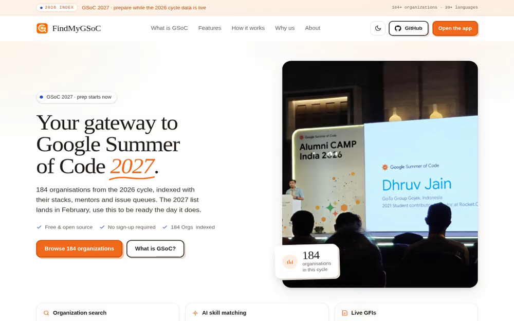
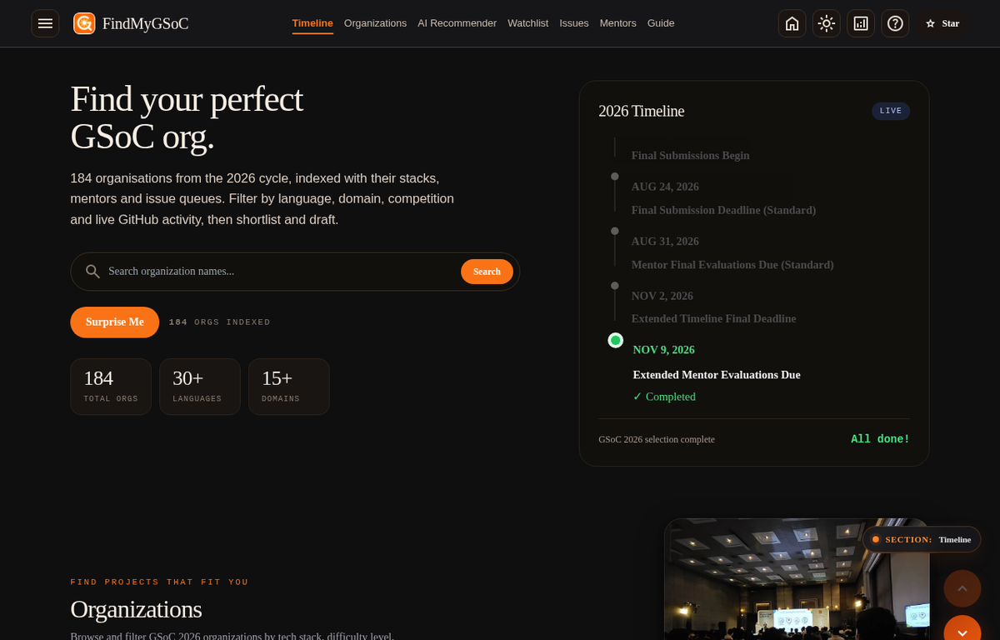
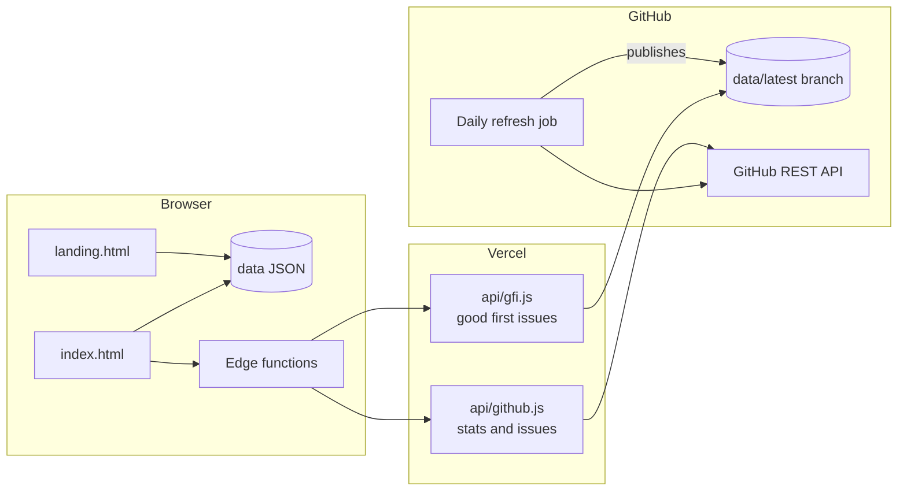

<div align="center">


# FindMyGSoC

**Find the Google Summer of Code organisation that actually fits you.**

Search 184 organisations from the 2026 cycle by stack, domain and competition.
Track their live good first issues. Shortlist, compare, and draft your proposal,
all in the browser, with no account and no build step.

[**Open the site**](https://findmygsoc.vercel.app/) ·
[Quick start](#quick-start) ·
[How it works](#how-it-works) ·
[Contributing](CONTRIBUTING.md)

[](https://github.com/S3DFX-CYBER/FindMyGSoC/actions/workflows/code-quality.yml)
[](LICENSE)
[](#quick-start)

</div>

[](docs/assets/demo.mp4)

*A 13 second walkthrough, recorded from the live pages. Click the frame to play
([docs/assets/demo.mp4](docs/assets/demo.mp4), 900 KB).*

---

## Why this exists

> FindMyGSoC has been part of **NSoC** and **GSSoC** as a participating open
> source project. Those programmes brought the contributors who built the
> filtering, the mentor directory, the badge system and much of the polish you
> see here. Every contributor follows the same guide: [CONTRIBUTING.md](CONTRIBUTING.md).

Every GSoC season the same problem repeats: the organisation list is a wall of
names, and the things that actually decide whether you can contribute — what
language the codebase is in, how competitive the org is, whether they have issues
you can start on this week — are spread across 184 different repositories.

FindMyGSoC puts those answers on one screen. It is a static site, a daily data
job and two edge functions. Nothing to install, nothing to sign up for, and it
still works when your connection does not.

## What it does

| Feature | What it gives you |
|---|---|
| **Search and filter** | 184 organisations by category, language, competition level and codebase difficulty, with instant client-side filtering and no round trips. |
| **Live good first issues** | 45 open, beginner-friendly issues pulled from the organisations' own repositories, refreshed daily. Filtered by language and category. |
| **Skill matching** | Paste a GitHub username or a resume and get a ranked shortlist, with the reasoning shown rather than a black box. |
| **Compare** | Put up to three organisations side by side: years in GSoC, mentor count, stack, competition and activity. |
| **Watchlist and deadlines** | Save organisations locally, and follow the GSoC timeline with the dates that matter for the current cycle. |
| **Proposal workspace** | Draft your proposal against the org's ideas page, and export it as a PDF when it is ready. |
| **Works offline** | A service worker caches the shell, the dataset and the fonts, so a flaky connection does not lose your place. |

## Screenshots

| Landing | App, dark theme |
|---|---|
|  |  |

| Organisation detail |
|---|
|  |

## Quick start

There is no build step and no package to install to view the site.

```bash
git clone https://github.com/S3DFX-CYBER/FindMyGSoC.git
cd FindMyGSoC

# any static server works
npx serve . -l 3000
```

Then open <http://localhost:3000>. Opening `index.html` directly works too, but a
local server is closer to production: the pages fetch JSON and a component.

If you want the tooling (lint and tests):

```bash
npm ci
npm test          # 38 tests across 10 files, node:test, no framework
npm run lint      # ESLint, Stylelint, HTMLHint
npm run validate:data
```

## How it works

Three moving parts, deliberately kept small.



**The pages** are plain HTML, CSS and JavaScript. No framework, no bundler. The
dataset ships as static JSON, so the first paint never waits on the network.

**The refresh job** runs every day at 03:00 UTC. It walks the organisation list,
pulls their open beginner-friendly issues from the GitHub API and publishes the
result to an unprotected `data/latest` branch. That detail matters: `main` is
protected, and a refresh that waits for a human review is a refresh that stops
happening.

**The edge functions** serve that dataset and the live GitHub stats, with caching
that differs per source so a degraded answer is never cached as though it were a
good one.

## API

Two edge functions back the live data. Both are public and cached at the edge.

| Endpoint | Query | Returns |
|---|---|---|
| `/api/github.js` | `repo=owner/name` | Repository stats: stars, forks, open issues, last push. |
| `/api/github.js` | `repo=owner/name&gfi=1` | Beginner-friendly issues for that repository. |
| `/api/github.js` | `repo=owner/name&issues=1` | Open issues with labels. |
| `/api/github.js` | `user=login` | Public profile and repository languages, used by skill matching. |
| `/api/gfi.js` | none | The full daily good-first-issue dataset, also served at `/data/issues.json`. |

## Project structure

```
.
├── index.html              # the app: grid, filters, watchlist, issues, mentors, guide
├── landing.html            # the marketing page
├── privacy.html            # what is stored, and where
├── src/
│   ├── styles.css          # app design system and components
│   ├── landing.css         # landing page design system
│   ├── js/                 # app logic, matching, rendering, badges
│   ├── components/         # footer and other partials
│   └── assets/             # icons and photography
├── api/
│   ├── github.js           # edge function: organisation stats and issues
│   └── gfi.js              # edge function: the daily good-first-issue dataset
├── data/                   # organisations, mentors, issues, cached summaries
├── scripts/                # data generation, validation and maintenance
├── tools/tenet-agent/      # the Python PR review agent used by CI
├── tests/                  # node:test suites
└── docs/                   # technical notes and README assets
```

More detail on any of this lives in [docs/TECHNICAL.md](docs/TECHNICAL.md).

## Data and correctness

The organisation list, mentor contacts and cached summaries live in `data/` and
are validated in CI:

```bash
npm run validate:data
```

The live datasets are separate on purpose. Issues and mentor contacts change
weekly, so they are generated by scripts in `scripts/` rather than edited by
hand, and the issue dataset is published from the refresh job instead of being
committed to `main`.

## Security notes

- Untrusted text from GitHub, resumes and search input is escaped before it
  reaches the DOM; the renderer uses a tagged template that escapes by default.
- Outbound links are validated against an allowlist of schemes before they are
  rendered as `href`.
- Nothing leaves the browser except the GitHub username you choose to analyse.
  The watchlist, badges and theme live in `localStorage`; there is no account and
  no server-side profile.
- HTML coming back from the GitHub API is sanitised with DOMPurify before it is
  inserted.
- Third-party scripts are pinned to exact versions, and the PDF exporter carries a
  subresource integrity hash.

## Testing

```bash
npm test
```

38 tests covering filtering, recommendation scoring, skill extraction,
sanitisation, issue parsing, the modal flow, cache behaviour and the service
worker, using `node:test` and no test framework.

## Deploy your own

1. Fork the repository.
2. Import it into Vercel. The framework preset is *Other*; `vercel.json` already
   maps `/` to the landing page, `/app` to the application and `/data/issues.json`
   to the edge function.
3. Optional: set `GITHUB_TOKEN` in the project environment to raise the API rate
   limit for live organisation stats.
4. Deploy. There is nothing to build.

## Contributing

Contributions are welcome, and the repository is set up to make them easy to land:
issue templates, a pull request template, DCO sign-off, and a review workflow.

One guide covers every contributor, whether you arrived through NSoC, GSSoC or
found the repository on your own: [CONTRIBUTING.md](CONTRIBUTING.md). Pick up an
issue labelled `good first issue`, and read the
[Code of Conduct](CODE_OF_CONDUCT.md) and the [AI policy](AI_POLICY.md) before you
open a pull request. If you are an AI agent, start with [AGENTS.md](AGENTS.md).

## Sponsoring

FindMyGSoC is maintained in spare time and stays free, without accounts, ads or
tracking. If it saved you an evening of reading 184 repositories, you can support
it through **GitHub Sponsors**:

[**Sponsor this project**](https://github.com/sponsors/S3DFX-CYBER)

Sponsorship pays for the domain, the API rate limits and the time it takes to
review contributions. Sponsors are credited on the landing page.

## Contributors

Everyone who has landed a pull request, in order of first contribution. This
section is maintained by the [backfill workflow](.github/workflows/add-contributor.yml).

<!-- CONTRIBUTORS_START -->
<!-- CONTRIBUTORS_END -->

## License

[MIT](LICENSE).

## Photography

The photographs on the landing and application pages were taken by the project
maintainer at Google Summer of Code Alumni Camp India 2026 (24 July 2026) and are
published with the consent of the people shown.
